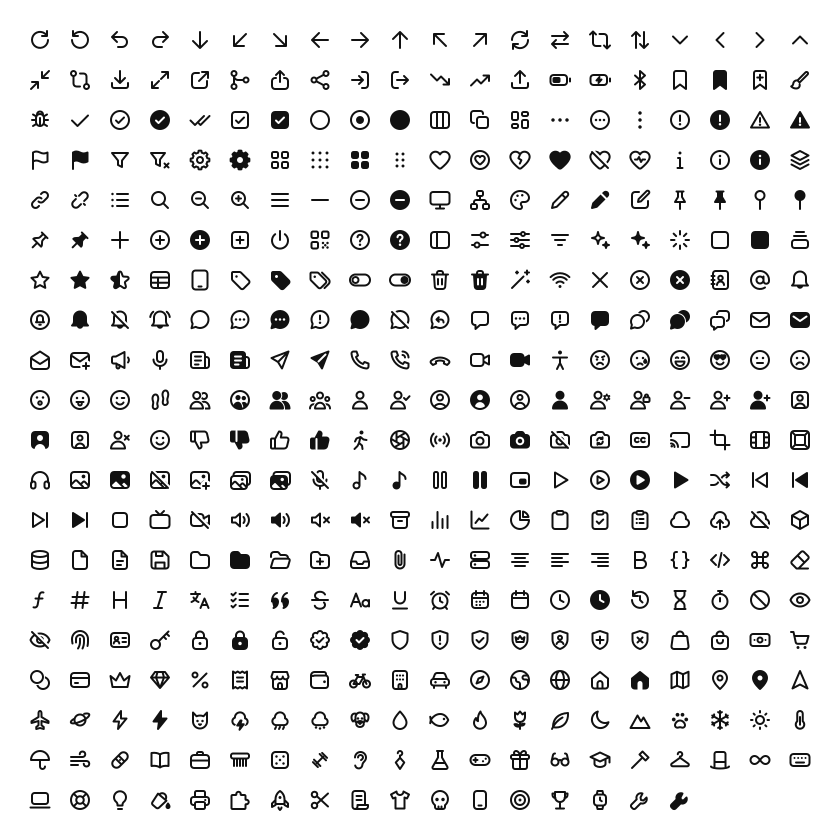

# @bulle/icons

Open source icon font for web and React Native.



Icons are drawn on a 24 unit grid with a 2 unit stroke. Some icons also have a filled version, named with `-fill` (`heart`, `heart-fill`).

## Install

```bash
npm i @bulle/icons
```

## Web

```html
<link rel="stylesheet" href="node_modules/@bulle/icons/dist/bulle-icons.css">

<p>Tap <i class="bi bi-heart"></i> to like.</p>
<button><i class="bi bi-paper-plane"></i> Send</button>
```

With a bundler, the stylesheet is imported from JavaScript.

```js
import '@bulle/icons/css'
```

Icons have the `font-size` and `color` of their parent.

| Class | Effect |
|---|---|
| `bi-sm` | 0.875 × the text size |
| `bi-lg` | 1.25 × the text size |
| `bi-xl` | 1.5 × the text size |
| `bi-2x` | 2 × the text size |
| `bi-3x` | 3 × the text size |
| `bi-fw` | fixed width of 1.25em |
| `bi-spin` | turning icon, still when reduced motion is on |

## React Native

```jsx
import { BulleIcon } from '@bulle/icons/react-native'

<Text style={{ fontSize: 16 }}>
  Tap <BulleIcon name="heart" /> to like.
</Text>

<BulleIcon name="paper-plane" size={24} color="#1d9bf0" />
```

Inside a `Text`, an icon has the size and the color of that text.

| Prop | Value |
|---|---|
| `name` | icon name |
| `size` | font size |
| `color` | text color |
| `style` | text style |

The font has to be in the app before icons are rendered. With Expo, add it with the `expo-font` plugin, at build time.

```json
{
  "expo": {
    "plugins": [
      ["expo-font", { "fonts": ["./node_modules/@bulle/icons/dist/react-native/fonts/BulleIcons.ttf"] }]
    ]
  }
}
```

The font can also be loaded when the app starts.

```jsx
import { useFonts } from 'expo-font'
import { FONT_FAMILY } from '@bulle/icons/react-native'
import font from '@bulle/icons/react-native/font'

const [loaded] = useFonts({ [FONT_FAMILY]: font })
```

Without Expo, list the folder `./node_modules/@bulle/icons/dist/react-native/fonts` in `assets` in `react-native.config.js`, then run `react-native-asset`.

## Web component

```html
<script type="module" src="node_modules/@bulle/icons/dist/bulle-icon.js"></script>

<bulle-icon name="heart"></bulle-icon>
<bulle-icon name="heart" label="Like"></bulle-icon>
```

The script contains the font, the stylesheet is not needed. `label` is read by screen readers. Icons without `label` are hidden from screen readers.

## Files

| File | Content |
|---|---|
| `dist/bulle-icons.css` | stylesheet |
| `dist/fonts/` | font in ttf, woff and woff2 |
| `dist/bulle-icon.js` | web component |
| `dist/react-native/` | React Native component and font |
| `dist/svg/<name>.svg` | one SVG per icon |
| `dist/sprite.svg` | all icons as `<symbol>`, for `<use href="#bi-heart">` |
| `dist/icons.json` | markup, codepoint, category and keywords of each icon |
| `dist/index.js` | `icons`, `iconNames`, `getIcon()`, `toSvg()` and one export per icon |
| `dist/demo/index.html` | list of icons |

## List of icons

```bash
npm run demo
```

Run it to build the package and open the list of icons in the browser. In the search field, type a name or a use: `settings` for `gear`, `search` for `magnifier`.

## Commands

| Command | Result |
|---|---|
| `npm run build` | `dist/` and `preview.svg` |
| `npm run lint:icons` | check of the icons |
| `npm test` | test results |
| `npm run demo` | build, then the list of icons in the browser |
| `npm run new -- <name> <category> <keyword>` | a new icon |

## Repository

```
icons/                source icons
meta/catalog.json     category and keywords of each icon
meta/codepoints.json  codepoint of each icon
preview.svg           image of every icon, generated by `npm run build`
build/                build scripts
tools/                lint and new icon scripts
test/                 tests
dist/                 build output, not committed
```

## License

MIT. See [LICENSE](LICENSE).
